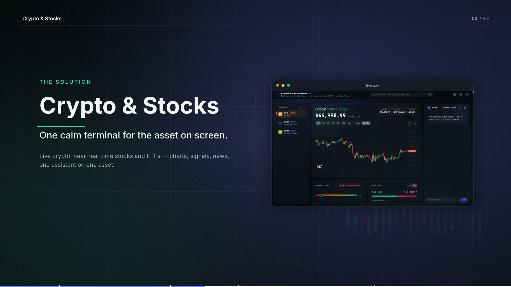

<p align="center">
  <a href="https://crypto-stocks-web-taupe.vercel.app">
    
  </a>
</p>

<h1 align="center">Crypto & Stocks Dashboard</h1>

<p align="center">
  <b>Real-time crypto, stocks & ETFs — live charts, an AI trading assistant, and read-only market signals in one dashboard.</b>
</p>

<p align="center">
  <a href="https://crypto-stocks-web-taupe.vercel.app">
    
  </a>
  <a href="https://github.com/AmineMabrouk17/crypto-stocks">
    
  </a>
</p>

<p align="center">
  
  
  
  
  
  
  
  
</p>

---

## ▶ Launch film

[](docs/brag/launch-film-en.mp4)

60 seconds · English · [Arabic version](docs/brag/launch-film-ar.mp4)

## 📈 Overview

**Crypto & Stocks Dashboard** is a real-time market terminal that tracks **cryptocurrencies, stocks, and ETFs** side by side — no account, no API keys, and no database required.

- **Crypto** prices stream live from **Binance** over WebSockets.
- **Stocks & ETFs** (AAPL, QQQ, SPY, …) are served near-real-time by **Yahoo Finance**.
- **Live charts** render on the open-source `lightweight-charts` engine.
- A **context-aware AI assistant** answers questions about the asset you're looking at — price action, fundamentals, and recent news — powered by a **free default Gemini model**, or your own key.
- **Market signals** show real market opinion: real-money **crowd odds** from Polymarket and the daily **Fear & Greed sentiment index** (crypto only).

It's designed to be **fast, private, and zero-setup**: all market data comes from free, read-only third-party APIs via thin server-side proxies, so you can clone it, run `pnpm dev`, and start trading a demo in under a minute.

## ✨ Features

### Core functionality
- **Real-time crypto prices** — WebSocket K-line streaming from Binance (`wss://stream.binance.com`).
- **Near-real-time stocks & ETFs** — quotes, intraday ranges, and search via Yahoo Finance.
- **Live interactive charts** — `lightweight-charts` with candlestick / line / area modes, multiple time ranges, and a **directional forecast** overlay.
- **Watchlist & asset search** — persistent across sessions, with one-click switching between assets.
- **Asset detail pages** — dedicated `/asset/[symbol]` route per instrument.
- **Price alerts** — set above/below targets with **browser notifications** (stored locally; fires while the asset is open).
- **Data export** — export chart candles to **CSV** and a portfolio summary to **PDF** (`jspdf`).

### AI assistant
- Ask anything about the selected asset — replies are grounded in the **live price, market stats, and asset description**.
- **No-key default**: ships with free Gemini models out of the box.
- **Bring your own key (BYOK)**: Gemini, OpenAI, Anthropic, Groq, or any OpenAI-compatible endpoint — your key lives in `localStorage` and goes **directly to your provider, never to the server**.
- Collapsible side panel, streaming-ready chat UI with animated text reveal.

### Market signals (crypto only)
- **Crowd Odds** — Polymarket's real-money probability that an asset closes up or down over a chosen **horizon (4h / 1D / 1W)**.
- **Sentiment Index** — the Alternative.me **Fear & Greed** gauge (0–100, Extreme Fear → Extreme Greed, updated daily).
- Read-only by design: **no user input is stored, nothing is ever written to a prediction market**.

### News & context
- **News feed** per asset from **Google News RSS**, with a lightweight positive/negative **keyword sentiment heuristic**.
- **Asset description panel** — what the asset is, fed into the AI assistant's context.

### UI / UX
- Responsive 3-column layout with a **collapsible chat sidebar**.
- **Light / dark theme** toggle (respects system preference).
- Motion-driven polish: text reveal, number tickers, animated badges, and stateful (idle → loading → success/error) buttons.
- Performance-friendly animations via the `motion` library.

## 🧱 Tech Stack

| Layer | Technology |
|-------|------------|
| Backend | Rust (axum, tokio, reqwest, serde, moka) |
| Framework | Next.js 16 (App Router, React 19, TypeScript) |
| Styling | Tailwind CSS v4, `cva`, `tailwind-merge` |
| Charts | `lightweight-charts` |
| Data fetching | SWR client hooks + Rust `/api/*` proxy with `Cache-Control` |
| Monorepo | pnpm workspaces + Turborepo |
| Testing | Cargo tests + wiremock endpoint parity tests |
| LLMs | Gemini, Groq, OpenAI, Anthropic, custom OpenAI-compatible endpoints |

## 🔌 Data Sources

All market data comes from free, read-only APIs — **no credentials needed**:

| Source | What it feeds |
|--------|---------------|
| Binance | Real-time crypto prices, K-line/WebSocket streams |
| Yahoo Finance | Stock & ETF quotes, search, company profiles |
| CoinGecko | Crypto market data & stats |
| Alternative.me | Fear & Greed sentiment index |
| Polymarket | Real-money crowd odds (up/down by horizon) |
| Google News RSS | Per-asset news feed with keyword sentiment |

## 🗺️ Roadmap & Suggested Issues

| Priority | Suggestion |
|----------|------------|
| 🔴 High | **Background price-alert monitoring** — alerts currently only trigger while their asset is open; a worker/PWA would let them fire anywhere |
| 🔴 High | **Portfolio & position tracking** — track buys/sells locally and compute P&L per asset |
| 🔴 High | **Shareable watchlists & layout sync** — export/import watchlists via a share URL |
| 🟠 Medium | **Real sentiment analysis** — replace the keyword heuristic with an LLM or proper NLP model |
| 🟠 Medium | **Technical indicators** — RSI, moving averages, and volume overlays on the chart |
| 🟠 Medium | **Localization (i18n)** — English, French, and Arabic UI strings |
| 🟠 Medium | **More horizon options & multi-asset signals** — extend crowd odds beyond 4h/1D/1W, and surface stock sentiment |
| 🟢 Low | **PWA / offline support** — installable app with cached watchlists and alerts |
| 🟢 Low | **E2E test coverage** — Playwright flows for search, chart, and chat |
| 🟢 Low | **WebSocket resilience** — backoff/reconnect strategies with exponential jitter |
| 🟢 Low | **Accessibility pass** — full keyboard navigation and ARIA audit |

## 🚀 Getting Started

### Prerequisites
- **Node.js 22+**
- **pnpm 10+**
- **Rust stable** (rustup; `cargo` must be on `PATH`)

### Run locally

```bash
# install dependencies
pnpm install

# start the Rust backend (:8080) and Next.js frontend (:3000)
pnpm dev

# start only one side
pnpm dev:backend
pnpm dev:web

# lint, typecheck, test, build
pnpm lint
pnpm tsc
pnpm test
pnpm build
```

The frontend proxies every `/api/*` request to the Rust backend. Set
`BACKEND_ORIGIN` in `apps/web/.env.local` (see `apps/web/.env.example`) if the
backend is not on `http://127.0.0.1:8080`. The backend itself is configured by
`HOST`, `PORT`, `CORS_ORIGINS`, `GEMINI_API_KEY`, `GROQ_API_KEY` and the optional
upstream URL/timeout variables documented in the root `.env.example`.

To run the backend in a container:

```bash
docker build -f rust/Dockerfile -t crypto-stocks-backend rust/
docker run --rm -p 8080:8080 -e GEMINI_API_KEY=... crypto-stocks-backend
```

On a systemd host (including the production VPS), install it as a supervised
service with automatic restart and a 1-minute health watchdog:

```bash
sudo bash rust/deploy/install-vps-service.sh
systemctl status crypto-stocks-backend
journalctl -u crypto-stocks-backend -f
```

Production builds default the `/api/*` rewrite to the VPS origin
(`http://88.99.81.55:8080`); local dev uses `http://127.0.0.1:8080`. Set
`BACKEND_ORIGIN` on the frontend host to override either. See
[`rust/ADR-006-vps-backend-service.md`](rust/ADR-006-vps-backend-service.md).

`GET /api/assets/resolve?symbol=&idHint=` is called once per asset navigation
(shared by `generateMetadata` and the page via React `cache()`), replacing the
old double server-side resolution.

> **Note for US deployments**: Binance geo-blocks US IPs. Swap the base URLs in `packages/lib/src/constants.ts` to `api.binance.us` / `stream.binance.us` if deploying from the US.

## 📁 Project Structure

```
crypto-stocks/
├── apps/
│   └── web/                  # Next.js dashboard (main app)
│       ├── app/              # routes: /, /asset/[symbol]
│       ├── components/       # dashboard, chart, chat, motion, settings
│       └── lib/              # client hooks (SWR, alerts, LLM settings, resolver cache)
├── packages/
│   └── lib/                  # @crypto-stocks/lib — client-safe types & helpers
├── rust/
│   ├── app/                  # axum HTTP front door (owns /api/*)
│   │   └── tests/            # wiremock endpoint parity tests
│   ├── crates/               # one crate per ported backend module
│   ├── deploy/               # systemd units + VPS installer
│   ├── Dockerfile            # multi-stage backend image
│   ├── MAP.md                # migration plan and state
│   ├── DECISIONS.md          # architecture decisions
│   └── ADR-006-vps-backend-service.md
├── docs/
│   └── adr/                  # architectural decision records
├── package.json              # Turborepo root
└── turbo.json
```

## 🏗️ Architecture Notes

- **Server-side proxies** (`/api/*`) are served by the Rust axum service, which owns a pooled `reqwest` client, in-process moka caches with single-flight deduplication, per-upstream timeouts and retries. Clients never hit the providers directly, absorbing rate limits (e.g., Polymarket Gamma is 300 req/10s per IP, shared across visitors).
- **Database-free & private**: no Supabase, no accounts, no user data. AI keys stay in the browser or are passed via env vars on the backend.
- **Decision-rich parsing lives in Rust** and is unit-tested against recorded fixtures; every endpoint also has a wiremock test asserting response-shape parity (`rust/app/tests/`).
- Architecture decisions are recorded in `rust/DECISIONS.md`.

## 🤝 Contributing

1. Fork the repo and create a branch from `main`.
2. Follow the [Conventional Commits](https://www.conventionalcommits.org/) convention (e.g., `feat:`, `fix:`, `style:`, `docs:`).
3. Run `pnpm lint && pnpm tsc` before pushing.

## 📄 License

All data is provided by third-party services under their own terms. This project is a private demo/learning build.
